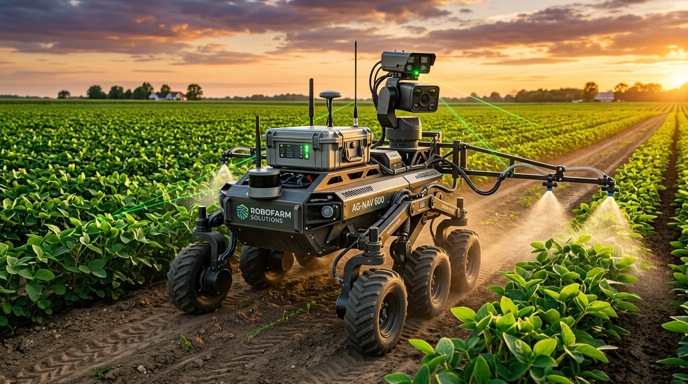
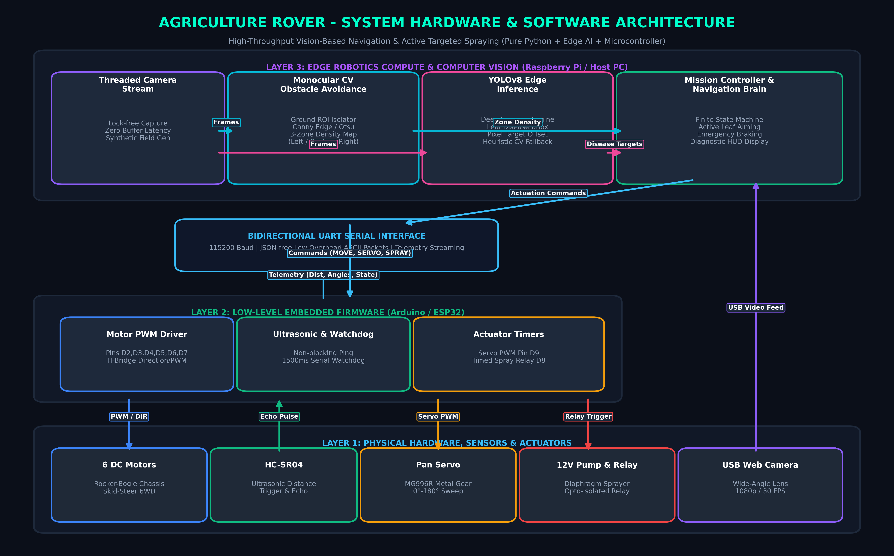
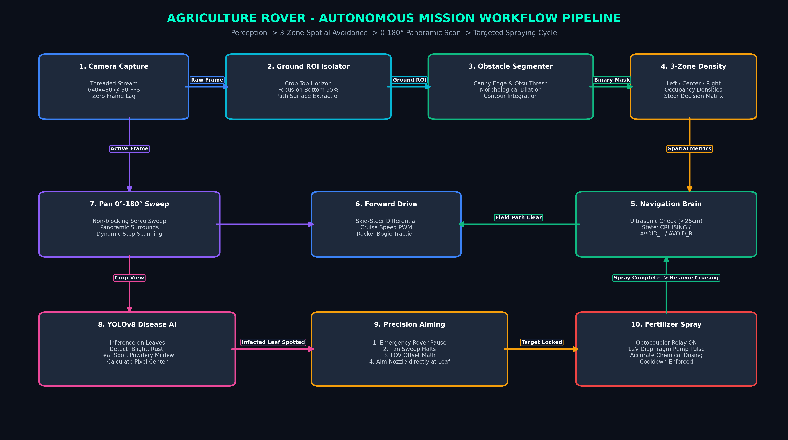

# 🌾 Autonomous Precision Agriculture Rover (Agri-Rover 6WD)



<div align="center">

[](https://www.python.org/)
[](https://isocpp.org/)
[](https://opencv.org/)
[](https://github.com/ultralytics/ultralytics)
[](https://www.raspberrypi.com/)
[](circuit_and_wiring_guide.md)
[](#system-architecture)
[](LICENSE)

**An industrial-grade, fully autonomous agricultural robotic system engineered for real-time monocular vision obstacle navigation, continuous 0°–180° panoramic canopy surveillance, and active targeted fertilizer spraying upon real-time YOLOv8 plant pathology detection.**

[System Architecture](#system-architecture) • [Workflow Pipeline](#autonomous-workflow-pipeline) • [Key Capabilities](#core-engineering-features) • [BOM & Pinouts](#bill-of-materials-bom--pinout-matrix) • [Quickstart](#deployment--installation) • [Showcase](#hardware-showcase--media)

</div>

---

## 📖 Executive Summary

The **Agri-Rover 6WD** is a specialized outdoor agricultural mobile robot featuring a **6-wheel rocker-bogie differential suspension system** capable of traversing uneven farm furrows, rocky terrain, and loose soil. The robotic brain utilizes an onboard **Raspberry Pi (4/5)** paired with an **Arduino/ESP32** microcontroller handling low-level motor drives and sensor acquisition via a deterministic serial protocol.

Unlike heavyweight ROS/ROS2 deployments that require substantial computational overhead, this rover runs a **lean, zero-ROS2 multi-threaded Python perception engine**. It combines monocular ground-plane segmentation for obstacle avoidance with an articulated pan-tilt scanning turret running **YOLOv8 edge inference** to autonomously identify fungal/bacterial leaf lesions and activate targeted micro-dosing fertilizer spray pulses.

---

## 🏛️ System Architecture



### ASCII Dataflow & Hardware-to-Perception Bus
```
====================================================================================================
 PHYSICAL SENSORS & ACTUATORS            EMBEDDED FIRMWARE (C++)             EDGE AI BRAIN (Python)
====================================================================================================
 [6 DC Gear Motors] <------- PWM/DIR --- [Arduino Uno / ESP32] <--- UART -- [Motor Controller]
   (Rocker-Bogie 6WD)                     - 6WD Differential Drive  (115.2k)  - Skid-Steer Kinematics
                                          - Emergency Watchdog                - Speed Clamping
                                          
 [HC-SR04 Ultrasonic] ---- Echo Pulse -> - Non-Blocking Ping ---- Telemetry -> [Autonomous Navigator]
   (Front Collision Guard)                - Safety Stop (<25cm)     Stream     - State Machine
                                                                               - Avoidance Trajectory
                                                                               
 [MG996R Pan Servo] <------- PWM Pin 9 - - Target Angle Register <- Set Angle - [Pan-Spray Controller]
   (0°-180° Turret)                       - Dynamic Step Sweeper              - Panoramic Scan Loop
                                                                              - FOV-to-Angle Math
                                                                              
 [12V Diaphragm Pump] <----- Relay D8 -- - Timed Spray Pulse <--- Trigger ---- - Active Target Aiming
   (Pressure Sprayer)                     - Overcurrent Guard                  - Dosing Cooldown
   
 [1080p Web Camera] ================= USB 3.0 Video Bus ====================> [Threaded Capture Stream]
   (Wide FOV Lens)                                                            - Lock-Free Frame Buffer
                                                                              - Zero-Latency Pipe
                                                                                      |
                                        +---------------------------------------------+
                                        |                                             |
                                        v                                             v
                           [Monocular Obstacle CV]                       [YOLOv8 Leaf Pathology AI]
                            - Ground ROI Isolator                         - Deep Learning Inference
                            - Canny Edge / Otsu Adaptive                  - Necrotic Spot Segmentation
                            - 3-Zone Density Map (L / C / R)              - Target Center (cx, cy)
====================================================================================================
```

---

## 🔄 Autonomous Workflow Pipeline



The operational mission loop executes through four synchronized subroutines:
1. **Threaded Perception Capture**: Continuous video ingest without OpenCV buffer latency or frame drops.
2. **Spatial Occupancy Evaluation**: Extracts the ground plane in the lower 55% of the frame, divides it into **Left**, **Center**, and **Right** zones, and calculates obstacle density metrics.
3. **Panoramic Turret Surveillance**: A top-mounted servo sweeps the camera across **0° to 180°**, conducting real-time inference on neighboring crop rows.
4. **Active Target Locking & Dosing**: When an infected leaf is recognized with confidence exceeding the threshold:
   - The rover executes an immediate motion brake.
   - The panoramic sweep pauses.
   - The camera horizontal pixel offset is mapped to servo pan angles to align the nozzle directly with the lesion.
   - The relay triggers a 1.5-second high-pressure fertilizer pulse.
   - Cruising navigation and 0°–180° scanning automatically resume.

---

## ⚡ Core Engineering Features

- **Real-Time Edge Inference**: Optimized YOLOv8 nano neural network pipeline capable of sustaining 25+ FPS on edge processors, paired with an OpenCV HSV chlorosis/necrosis lesion heuristic detector fallback.
- **Deterministic Zero-ROS2 Architecture**: Eliminates DDS daemon latency, node discovery serialization, and resource overhead by using thread-safe native Python with sub-millisecond inter-module communication.
- **Hardware-in-the-Loop (HIL) Simulation**: Integrated `MockSerialInterface` and `SyntheticFieldGenerator` enabling complete end-to-end mission debugging on laptops without requiring physical hardware.
- **Fault-Tolerant Watchdog Timer**: Embedded Arduino firmware enforces a 1500ms safety heartbeat; if communication with the host computer is interrupted, all motors immediately undergo dynamic braking.
- **6-Wheel Rocker-Bogie Dynamics**: Articulated rocker-bogie passive suspension equalizes weight distribution across all 6 wheels, maintaining traction over obstacles twice the wheel diameter.
- **Non-Contact Ultrasonic Safety Guard**: Interrupt-driven HC-SR04 sonar module ensures hard-stop obstacle override whenever an unsegmented barrier enters the 25cm critical collision perimeter.
- **Flyback-Protected Dosing Actuation**: Optocoupler-isolated relay circuit equipped with flyback diode suppressors to neutralize inductive back-EMF from the 12V diaphragm pump.

---

## 🛠️ Bill of Materials (BOM) & Pinout Matrix

### Hardware Bill of Materials
| Category | Component Description | Quantity | Operating Specs | Primary Function |
| :--- | :--- | :---: | :--- | :--- |
| **Edge Compute** | Raspberry Pi 4 Model B (4GB / 8GB) | 1 | 5.1V / 3.5A DC, Quad Cortex-A72 | Computer Vision & Mission Planner |
| **Microcontroller**| Arduino Uno R3 / Mega / Nano / ESP32 | 1 | ATmega328P / 16MHz, 5V Logic | Low-Level Motor & Actuator Firmware |
| **Drive Motors** | 12V High-Torque DC Metal Gearmotors | 6 | 12V DC, 60–100 RPM, 15 kg·cm | 6WD Rocker-Bogie Traction |
| **Motor Drivers** | BTS7960 43A H-Bridge / L298N Dual | 2 | 6V–27V, High-Current Dual PWM | Differential Left/Right Drive Banks |
| **Turret Servo** | MG996R High-Torque Metal Gear Servo | 1 | 4.8V–7.2V, 11 kg·cm Torque | 0°–180° Panoramic Scan Mechanism |
| **Fluid Pump** | 12V DC Diaphragm Micro Water Pump | 1 | 12V DC, 2.5 L/min, 0.48 MPa | Precision Fertilizer Spray Delivery |
| **Pump Actuator** | 1-Channel 5V Optocoupler Relay Module | 1 | Active LOW Trigger, 10A 250VAC | High-Current Inductive Pump Switch |
| **Proximity Sensor**| HC-SR04 Ultrasonic Distance Sensor | 1 | 5V DC, 2cm–400cm Detection Range | Collision Braking Sensor |
| **Vision Sensor** | 1080p Wide-Angle USB Camera | 1 | USB 2.0 / 3.0, 60° Horizontal FOV | Obstacle Avoidance & Leaf AI Input |
| **Power Storage**| 3S Li-ion (11.1V–12.6V) or 12V 7Ah SLA | 1 | 12V Nominal, 5Ah–10Ah Capacity | Master Mobile Power Source |
| **Regulators** | LM2596 / XL4015 Step-Down DC-DC | 2 | 12V -> 5V 3.5A & 12V -> 6V 3A | Clean Power for Pi, Servo, Logic |

### Microcontroller Pinout Assignment

| Peripheral Subsystem | Signal Pin | Arduino Pin | Logic Level | Hardware Behavior |
| :--- | :--- | :---: | :---: | :--- |
| **Left Motor Bank** | PWM Speed (`ENA`) | `D5` | 5V PWM | Hardware Timer PWM (0–255) |
| **Left Motor Bank** | Direction 1 (`IN1`)| `D4` | 5V Digital | Forward / Reverse H-Bridge Logic |
| **Left Motor Bank** | Direction 2 (`IN2`)| `D2` | 5V Digital | Forward / Reverse H-Bridge Logic |
| **Right Motor Bank**| PWM Speed (`ENB`) | `D6` | 5V PWM | Hardware Timer PWM (0–255) |
| **Right Motor Bank**| Direction 1 (`IN3`)| `D7` | 5V Digital | Forward / Reverse H-Bridge Logic |
| **Right Motor Bank**| Direction 2 (`IN4`)| `D3` | 5V PWM | Hardware Timer PWM (0–255) |
| **Pan Servo Turret**| Control Signal | `D9` | 5V PWM | 50Hz Servo Control Signal |
| **Spray Relay** | Relay Trigger | `D8` | 5V Digital | Active-LOW Isolation Trigger |
| **Ultrasonic** | Trigger Pulse | `D12` | 5V Digital | 10µs High Pulse |
| **Ultrasonic** | Echo Timing | `D11` | 5V Digital | Pulse Width Duration Measurement |
| **Host Serial Bus** | TX / RX | `USB Port` | Serial TTL | 115200 Baud Communication Link |

*For complete electrical schematics, power rail separation, and flyback diode wiring, refer to [circuit_and_wiring_guide.md](circuit_and_wiring_guide.md).*

---

## 🚀 Deployment & Installation

### 1. Embedded Firmware Deployment (Arduino / ESP32)
1. Open the Arduino IDE (or PlatformIO).
2. Install the built-in `Servo` library (included with standard Arduino AVR cores).
3. Connect the microcontroller via USB.
4. Open the firmware source:
   ```text
   firmware/arduino_rover_controller/arduino_rover_controller.ino
   ```
5. Select board type (**Arduino Uno**, **Mega**, or **Nano**) and the corresponding COM/tty port.
6. Click **Upload**. Open Serial Monitor at **115200 baud** and send `PING` to confirm `PONG` response.

---

### 2. Host Computer / Raspberry Pi Vision Environment
#### Automated Setup
- **Windows**:
  ```powershell
  setup_env.bat
  ```
- **Raspberry Pi / Linux**:
  ```bash
  chmod +x setup_env.sh run_rover.sh
  ./setup_env.sh
  ```

#### Manual Environment Configuration
```bash
# 1. Clone repository
git clone https://github.com/<your-username>/agriculture-rover.git
cd agriculture-rover

# 2. Initialize virtual environment
python -m venv .venv

# Activate on Windows:
.venv\Scripts\activate
# Activate on Linux / Raspberry Pi:
source .venv/bin/activate

# 3. Install core dependencies
pip install --upgrade pip
pip install -r requirements.txt

# 4. Download base weights
python models/download_weights.py
```

---

## 🎮 Execution & Runtime Modes

### A. Full Mission Execution (Physical Rover)
```powershell
# Automatically finds connected Arduino and default webcam:
python main.py

# Specify explicit serial port and camera index:
python main.py --port COM4 --camera 0
```

### B. Hardware-in-the-Loop Simulation (Laptop / Development Mode)
Run the entire perception, state machine, and HUD simulation without a physical robot or camera connected:
```powershell
python main.py --mock
```
*or execute the standalone virtual testing script:*
```powershell
python simulation/test_virtual_rover.py
```

### C. Live Diagnostics & Calibration Suite
```powershell
# 1. Real-time Camera and Ground ROI Calibration:
python scripts/calibrate_camera.py

# 2. Interactive Actuator Diagnostic Terminal:
python scripts/test_hardware.py

# 3. Vision Pipeline & Disease Visualizer:
python scripts/test_vision_pipeline.py
```

---

## 📸 Hardware Showcase & Media

### Physical Rover Photographs
High-resolution images of the physical 6-wheel rocker-bogie assembly, controller box, and pan mechanism are archived in [`assets/photos/`](assets/photos/):

| Chassis & Suspension | Electronics & Controller Enclosure | Pan Turret & Spray Head |
| :---: | :---: | :---: |
|  |  |  |
| *6WD Rocker-Bogie PVC & Iron Chassis* | *IP-Rated Controller Box with RPi & Arduino* | *MG996R Articulated Pan-Tilt Mechanism* |

*(Place project photos into [`assets/photos/`](assets/photos/) following the naming guide in [`assets/photos/README.md`](assets/photos/README.md).)*

---

### Field Demonstration Videos
Video recordings documenting autonomous navigation and targeted spraying are indexed in [`assets/videos/`](assets/videos/):

| Autonomous Navigation & Obstacle Avoidance | Panoramic 0°–180° Scan & Disease Spray | Full Field Deployment |
| :---: | :---: | :---: |
| `assets/videos/autonomous_navigation_demo.mp4` | `assets/videos/pan_scan_and_spray_routine.mp4` | `assets/videos/field_testing_action.mp4` |
| *Ground-plane vision obstacle maneuvering* | *Active lock-on and relay dosing pulse* | *End-to-end autonomous field row trial* |

---

## 📄 License & Attribution

This project is released under the **MIT Open Source License**. Developed for precision agriculture, edge computer vision research, and autonomous robotics applications.
